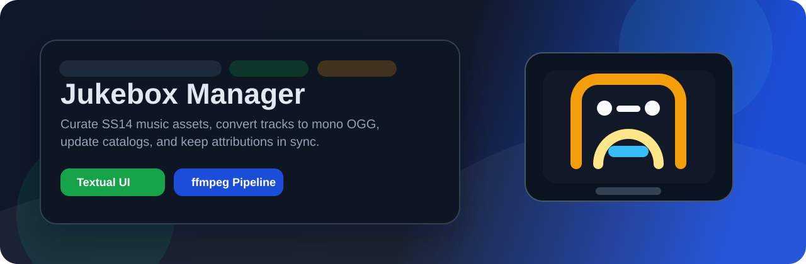

# Jukebox Manager

<p align="center">
  
</p>

<p align="center">
  <a href="#"></a>
  <a href="#"></a>
  <a href="#"></a>
  <a href="#"></a>
</p>

<p align="center">
  A small content pipeline tool for managing <strong>Space Station 14</strong> jukebox tracks, converting audio to mono OGG, updating catalog prototypes, and keeping attribution files in sync.
</p>

## Preview

<p align="center">
  

</p>

## What It Does

- Imports supported audio files directly into the SS14 `Resources/Audio/.../Jukebox` folder.
- Converts incoming tracks to mono `.ogg` with `ffmpeg`.
- Appends jukebox entries to `Resources/Prototypes/.../Catalog/Jukebox/Standard.yml`.
- Lists tracks from **all** jukebox catalogs at once (public plus variants such
  as `_MegaHetero`), tagged with their source, e.g. `[public]`, `[_MegaHetero]`.
- Creates default attribution entries in `attributions.yml`.
- Removes catalog entries, audio files, and matching attribution records from one place
  (only the entry's own catalog file is rewritten).
- Includes a separate batch MP3-to-OGG converter utility.

## Supported Audio Formats

`ogg`, `mp3`, `wav`, `flac`, `aac`, `m4a`, `wma`, `opus`

## Quick Start

### 1. Install dependencies

```powershell
python -m pip install --upgrade pip
python -m pip install -r requirements.txt
```

### 2. Install `ffmpeg`

`app.py` shells out to `ffmpeg`, so it must be installed and available on your `PATH`.

### 3. Optional: configure a resource variant or custom destination

Create a local `.env` file from `.env.example`:

```env
RESOURCE_VARIANT=
JUKEBOX_AUDIO_DIR=
JUKEBOX_CATALOG_FILE=
```

If set, the app writes into variant-aware paths such as:

- `Resources/Audio/<variant>/Jukebox`
- `Resources/Prototypes/<variant>/Catalog/Jukebox`

For a private dir (binaries git-ignored, metadata committed), use:

```env
RESOURCE_VARIANT=_MegaHetero
# or explicitly:
# JUKEBOX_AUDIO_DIR=Resources/Audio/_MegaHetero/Jukebox
# JUKEBOX_CATALOG_FILE=Resources/Prototypes/_MegaHetero/Catalog/Jukebox/Standard.yml
```

When adding tracks, the Add dialog asks for a **variant name** instead of a
directory: leave it empty for the `.env` default, type `public` for the public
tree, or `_MegaHetero` for the private one. The matching catalog file is
created automatically when missing, and prototype `/Audio/...` paths always
point at the separated variant audio dir, e.g.
`Resources/Audio/_MegaHetero/Jukebox` ->
`Resources/Prototypes/_MegaHetero/Catalog/Jukebox/Standard.yml` with paths
`/Audio/_MegaHetero/Jukebox/<file>.ogg`.

The list is grouped by catalog with `== [tag] path (N tracks) ==` headers, so
you can always tell what lives where. `Open Catalog` / `Open Audio` follow the
currently selected row (header or track); with nothing selected they open the
configured defaults. `Remove` deletes the selected track from its own catalog
file only — headers cannot be removed.

### 4. Launch the manager

```powershell
python app.py
```

Or use the helper script:

```powershell
.\app.bat
```

## Usage

### Jukebox Manager

- Press `A` to add audio files.
- Press `D` to remove the selected track.
- Press `C` to open the catalog folder.
- Press `U` to open the audio folder.
- Press `R` to refresh the list.
- Press `Q` to quit.

You can also drag files into the terminal or paste multiple paths into the add dialog.

### MP3 to OGG Converter

For standalone batch conversion:

```powershell
python mp3toOgg.py
```

Or:

```powershell
.\mp3toOgg.bat
```

## Project Layout

```text
app.py                Textual jukebox manager
mp3toOgg.py           Standalone batch converter
requirements.txt      Python dependencies
app.spec              PyInstaller config for app.py
mp3toOgg.spec         PyInstaller config for mp3toOgg.py
assets/               GitHub README artwork
```

## Build Executables

```powershell
pyinstaller --onefile --windowed app.py
pyinstaller --onefile --windowed mp3toOgg.py
```

Or use:

- `.\build.bat`
- `.\build mp3toOgg.bat`

## Notes

- The app assumes this repository lives near an SS14 content tree because it writes to relative `Resources/...` paths.
- Attribution entries are added with placeholder metadata and should be reviewed before shipping content.
- Generated binaries, virtual environments, caches, and local `.env` files are ignored by Git via `.gitignore`.
